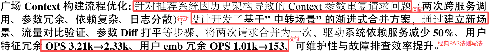

# 一. 全栈、后端、Agent指南介绍
## 1. UP BG
- **学历**：up是**双非本末2硕**，27应届生，本硕都是**科班**，虽然看起来还行，但是放现在的后端方向，基本就是路边一条了，没有一点优势。
- **实习**：up第一段实习找了4个月才找到，这4个月中大厂就2个给面，只能说最后运气不错，第一段去了中厂C端核心(干了4个月)，基本上秋招全靠这段兜着。第二段实习是去了一家老牌AI Top厂，主要是做OpenClaw二开，整体还是比较水，干了两个月果断跑路准备秋招。
- **竞赛**：本科打过ACM，但是双非ACM懂的都懂，除了那几个强校，基本都不行，当然最主要还是up比较摆实力不行。虽然成绩一般，但是找工作算法题应该是没啥问题。
- **项目**：除了实习项目，简历上还写了up提pr的一个开源项目。
- **书籍**：up有看技术书的习惯，简历有提7本书。
- **秋招Offer**：目前收到字节意向，百度、小米、去哪旅行池子中。
## 2. 简介
- 本指南主要是针对全栈、后端、Agent的同学，整个指南都是个人观点，不一定是对的，大家参考一下就行。
***
# 二. 方向BG要求和找工作的因素
## 1. 方向BG要求
- 无论实习还是秋招，最低最低都得是**双非本及以上**。学历越低一般越难找，特别是第一段，基本上不会有什么中大厂面试(参考up)。学历高面试会比较多，但是面试多也不一定过，主要看面试表现。
- 特别是你会发现很多同学比如**实习能去公司a**，但是**秋招直接简历挂**，这是很正常的，因为实习==外包，学历差点能干活就行，但是秋招是有正式hc的。
- 对于**27届秋招**来说的话，基本上**学历不好**，**大部分中大厂与你无缘了，除非经历【特别亮眼】(简历挂。up快手、美团、滴滴、携程、阿里、腾讯等大厂和几乎所有中厂全部简历挂)**。**27秋招大家抱怨最多的不是面试面不过，而是没有面试。**
- **如果学历不好，又没有实习的话，基本上不会有啥中大厂面试。但是有实习的话，还是有些不卡学历的，好好面试，还是能够OC。**
- **学历越低，秋招想要上岸，付出的努力要成倍的增长。**
## 2. 校招找工作的因素
- **拿到中大厂offer = 运气50% + 学历40% + 实力10%。**
- 我自己**无论找实习还是秋招**，体感就是上面，**没有学历==几乎没有面试**(up找第一段实习投了4个月就3个中大厂面试)。
- 不过bg比较差的同学也不用过分焦虑，**学历不是我们能改变的，但实力可以吃掉运气的。新公式 = 运气20% + 学历40% + 实力40%(实力强+有亮眼实习经历)。** **所以对于BG弱的同学，一定要有实习！！！**
***
# 三. 学习路线
## 1. 投后端、Agent、全栈，需要学哪些？
- 无论投哪个(后端、Agent、全栈)，前端可以不学。**后端、Agent一定要学**，无论是后端还是全栈还是Agent。
## 2. 语言
- 我个人感觉Java和Go作为主语言吧，py可以选学。只会py应该很难找后端岗。
- Java和Go的话，up学的是Java，虽说语言不重要，但是具体公司具体组对语言的容忍度是不一样的。一般来说Java可以转Go，Go很难转Java。而且基本国企银行都是Java为主。
## 3. 路线
- 如果想要速成，就直接背八股，只要能理解，哪里实在背不懂再去看对应视频。看视频是最浪费时间的，时间充裕的话可以看经典书籍。
### ①语言基础
- **文档**：基础好，直接看文档，刷力扣，半个月差不多了。
- **视频**：0基础可以B站找最新的视频，因为有时效性我就不推荐了。
- **书籍**：喜欢看书的同学，我推下我看过的3本书吧，《Java核心技术卷1-2》、《EffectiveJava》
- **八股**：非0基础直接背小林Coding、JavaGuide
### ②框架
- Java的话就SpringMVC、SpringBoot、SpringCloudeAlibaba、Mybatis这几个。
- Go的话国内外的选个主流的就可以，Go-Zero这些。
- **视频**：0基础可以B站找最新的视频。
- **八股**：非0基础直接背小林Coding、JavaGuide
### ③JVM
- java的虚拟机，go是没有的。
- **视频**：0基础可以B站找最新的视频。
- **八股**：非0基础直接背小林Coding、JavaGuide。
### ④数据结构
- 就是堆、栈、链表、队列、树这些，都要学会并理解，并且能够手动实现。
- **视频**：0基础b站看视频学。
- **八股**：非0基础直接背小林Coding、JavaGuide
### ⑤操作系统
- 线程、进程、协程，内存，中断等等内容。
- **视频**：0基础b站看视频学。
- **八股**：非0基础直接背小林Coding、JavaGuide
### ⑥计算机网络
- TCP/IP、网络分层、握手挥手、DNS流程等等。
- **八股**：直接背小林Coding、JavaGuide，看视频纯浪费时间，面试问的基本就常见八股。直接看八股看不懂，也可以先去b站看视频。
### ⑦Mysql
- 主要是sql语言、索引、日志、事务等等。
- **视频**：0基础b站看视频学。
- **八股**：非0基础直接背小林Coding、JavaGuide
### ⑧Redis
- 主要是数据结构、应用这些。
- **视频**：0基础b站看视频学。
- **八股**：非0基础直接背小林Coding、JavaGuide
### ⑨消息队列
- RocketMQ、Kafka至少要学一个，up学的是RocketMQ。
- **视频**：0基础b站看视频学。
- **八股**：非0基础直接背小林Coding、JavaGuide
- **书籍**：《ApacheRocketMQ进阶之路》up看了，讲的很好。
### ⑩Linux
- 主要是常见命令和Git
- **视频**：0基础b站看视频学。
- **八股**：非0基础直接背小林Coding、JavaGuide
- **书籍**：up看的是《UbuntuLinux系统管理与运维实战》
### ①①Docker
- **选学**。中大厂都有完善的平台，实际也用不到你去打包镜像。
- **书籍**：up看的是《Docker技术入门与实战》
### ①②分布式
- 直接背八股即可，小林Coding、JavaGuide。觉得难以理解可以b站先看视频。
### ①③Agent
- 说实话up是直接背的八股学的，然后自己找技术文章补充学习，以及做开源项目。
- 直接小林coding背完八股就会了，觉得比较难以理解可以b站视频。八股只背这个不够，需要自己再找技术文章和面经学习。
- **链接**：https://xiaolinnote.com/ai/
### ①④算法
- 力扣h100刷熟练，基本够用，有余力可以刷别的。https://leetcode.cn/studyplan/top-100-liked/
- sql力扣常见50道够用。https://leetcode.cn/studyplan/sql-free-50/
### ①⑤项目
- 建议一个微服务项目+一个ai相关项目(agent这种)。
- 微服务项目：不做点评这种烂大街的就行，实际不管做多好，因为没上线，所以还是玩具项目，最关键的是整个项目代码你都要理解。
- AI相关项目：开源agent提pr > 魔改开源agent > 其他无论自己vibe还是别人的agent项目。
***
# 四. 八股在哪找？
- 楼主主要是背的**小林coding**(https://xiaolincoding.com/interview/)，里面的都是常见的，背完能应付八成以上的八股。
- 有余力的可以看：**JavaGuide**补充(https://javaguide.cn/)。
- 小林和JavaGuide区别在于，小林是精简版的适合背，JavaGuide又多又全，适合背完小林补充。
- up是传统后端八股背了有十几遍吧，ai八股今年刚学的，只背了五六遍。基本上第一遍最难，up第一遍背传统八股，平均每天8小时，一个月背完。后面熟悉了一周复习完一遍。
# 五. 面试场景题怎么答？
- 个人感觉，面试非coding环节最难的是智力题，其次是场景题，但是up秋招没遇到过出智力题的，所以应该场景题最难了吧，这个模块也是最能拉开面评差距的环节之一。
- 但是场景题并没有想象中那么可怕，假如满分10分，你能答5分，就已经非常好了。因为一个场景题你在短短几分钟内不可能想的方案又完善又好，除非你原来遇到过类似的问题。所以你只需要比你的对手答得好就行了，比如这道题满分10分，平均3分，你的回答5分，那你就是No.1。
- up秋招过程中，只要中大厂几乎必问场景题的，甚至有的面试全问场景题别的啥也不问(字节、去哪旅行)，字节二面的时候全是AI场景题，up准备的比较充分，面完面试官说很优秀的同学，然后当天就过了。
- 场景题中，up体感是难度上：后端场景题>>AI场景题，主要是因为AI的内容还是比较少。
- **所以我们应该怎么准备场景题呢？**up认为主要是两方面：首先是**八股背的必须非常熟练**，八股都不懂，你可能场景题的关键点都get不到，比如多用户抢红包，如果你并发都不理解，怎么能Get到这个场景的一致性问题呢？所以，熟练的八股一定是场景题的基础。其次是，想要答出比别人好的方案，纯自己想是基本不可能的，所以需要**平时准备**。可以多看技术文章学习别人的思路。
- 你的**八股熟练+看过大量开源方案和技术文章**，其实技术都是通用的，面试问你这个问题，然后你就会想到之前看的一个方案的某个解决点刚好也适用这里，然后你直接稍微改下符合题目就答，这样你答的不仅和别人不同，而且你的答案都是根据真实业界方案(开源或技术文章)提炼出来的，不是自己瞎想的，那你的分一定是比别人高的。
# 六. 去哪找技术文章？
- up主要是看各个**大厂技术团队微信公众号**，比如美团技术团队、腾讯技术团队、阿里技术团队，你不仅能看到某个场景的对应的大厂真实落地方案，而且最新的文章一定是最前沿的，比如这些公众号最近都在发Agent的最新内容，这对你了解工程前沿和面试也是非常有帮助的。
- 
- **例子**：
- 分布式ID怎么做？答案：美团：https://tech.meituan.com/2017/04/21/mt-leaf.html
- Java线程池怎么设置参数(2倍或者+1纯理论)？答案：美团：https://tech.meituan.com/2020/04/02/java-pooling-pratice-in-meituan.html
- 大模型网关如何限流(跟后端网关限流是两码事)？答案：RocketMq官方：https://mp.weixin.qq.com/s/9BmWMFLqrXHxp7DzoZ8_uw
- 如何写好skill？答案：腾讯：https://mp.weixin.qq.com/s/SZv3pDXPrL9vwV3Ua_84Kg
- 
- 相信上述问题，大部门同学秋招都或多或少遇到过，如果你能参考文章的答案进行回答，这将会极大拉开这一题的差距，体现你的**工程素养和前沿能力**。
***
# 七. 如何做开源贡献？
- up是给开源agent提了pr，在字节三面的时候发挥了关键作用。三面面试官先是问我有没有提pr，然后又让我本地投屏看pr内容，但是up网络不好打不开，我以为到这就结束了，结果面试官让我把链接发给他，他自己看。
- 那么如何做开源贡献呢？相信很多同学，面对开源仓库这么代码，无从下手。
- **up的方法是**：先借助ai大概看代码，知道项目有哪些模块，以及各个模块关系是怎么样的(不要深入细节)->利用ai，看主流程的细节代码(不要看非主流程的)->利用ai找简单issue，自己先去尝试给解决方案，代码可以用ai写，这个解决issue的过程就是你深入了解各个模块的过程->解决完fork仓库，然后提pr到上游分支。只要不断解决issue，最后你就可以完全掌握整个项目，并且合并了大量pr，这是非常加分的。
***
# 八. 什么时候找？实习如何找？干多久跑路？暑期要不要转正？
## 1. 实习时间节点
- **个人认为难度(由易到难)**：
- 9月初~11月底(应届生都跑路秋招了，企业此时大量缺实习，基本不用横向，甚至面试轮次变少) < 
- 8月(暑期实习早的跑路了，up的第一段实习就是8月初找到的，问了mentor就是上个实习生跑路秋招了) < 
- 12月初~年前(会有应届生秋招不好再找实习，加上确实9月到11月招了一批下一届的) < 
- 年后~3月底(大部分人暑期实习都没开始，这个阶段是暑期最好找的，越早越好；up在这段拿了4个中大厂实习offer，比较可惜的是很多大厂开的晚，up赶不上) < 
- 4月初~5月底(各个公司陆陆续续暑期开始，但是大部分人都是集中这个节点投，还是挺难的) < 
- 6月初~7月底(基本都是暑期补招，oc早的人已经实习好几个月了)
## 2. 实习如何找
- **自己投递渠道**：Boss直聘、实习僧、企业官网
- **内推渠道**：这个内推不是随便填一个不认识的人的码，基本上没啥用。最好是往届师兄师姐在的组找，你把简历给他，组里Leader不管看不看上，至少是会有面试的。
## 3. 干多久跑路
- 没有固定时长，具体问题具体分析。
- 如果全是**dirty work**，包装完就赶紧下一段，越快越好，呆久了也是浪费时间
- 如果有**产出**，你能达到对所有项目模块都十分清除，哪怕问你简历外的东西，也能对答如流，且短时间内的需求没办法让你继续提升了，这时候可以考虑跑路了。
## 4. 暑期实习要不要转正？
- **一定要转正**，转正了成功了整个秋招就不用焦虑了，随便爽玩到毕业。
- 最近几年，特别是27届，秋招环境非常之差，牛客很多学历很好的同学(双2，双9)因为投的晚或者运气不好，面试都没几个。就算hr面完，横向挂的比比皆是。所以你如果不是大佬，能转正就转正吧，哪怕这个公司你再不想待。
***
# 九. 应届生简历写几页合适？如何写出优质简历？
## ①应届生简历写几页合适？
- 相信很多人都听过，简历不要超过一页，这话其实也没错，不过有前提，up的简历就是大长页，相当于2页。
- 如果你没有实习，都是自己项目，或者实习东西**比较水**，那么就**一页**吧，写的再多也是无效内容，反而面试破绽更大。
- 如果你有多段实习、或者**优质**项目(开源)，那么简历几页都可以，**没有限制**，优质的内容再多也是赏心悦目，并且增加你的核心竞争力。
## ②如何写出优质简历？
- 很多人都说用**star法则**(情境 → 任务 → 行动 → 结果)，其实按这个法则去写，项目每一行会非常**冗余**。
- up是按**par法则**(问题 → 行动 → 结果)写的简历，即：**出现什么问题 + 你是如何排查、如何解决的 + 解决问题后的收益是什么**。bullet point（一行写完）在简历上非常清晰明确，确实不如star法则全面，但是疑惑的地方都是等到面试追问的时候问的，简历每一条千万不要写的又臭又长，并且全程无高亮，否则你自己都不想看。
- up简历例子：

***
# 十. 秋招什么时候投？需不需要等大佬投完再投？
- **越早越好**，up7月就开始投，开一个投一个。
- 不要想着等大佬投完再投，后面所有人一起投，简历都不知道能不能被捞上来。
***
# 十一. 实习和秋招哪个难？为什么明明多段大厂实习，还是横向挂？应届校招需要什么水平才能横向出来？横向比的是什么？
## 1. 实习和秋招哪个难？
- 先说结论**秋招难度 >>>>>>>>>>>>>> 实习**。
- 虽然，秋招和暑期面试难度几乎差不多，但**秋招的hc数量 <<<<<<<<< 实习**。比如，50个暑期实习hc，到秋招只有10个正式hc(5倍算还可以，听说某些厂赛马8进1、10进1)。
- 总的来说 **实习生==外包**，而且比外包钱少，还好用，还听话。
- 由于秋招hc远少于实习hc，更导致哪怕你技术面全部通过，也要横向，大部分人都死在这一关，环境太差了。
## 2. 为什么明明多段大厂实习，还是横向挂？
- **经济上升期**：多段大厂实习 == 秋招大厂oc。
- **经济下降期**：几个都有大厂实习的同学面完hr面，然后开始进池子，然后究极横向，然后横向挂。
## 3. 应届校招需要什么水平才能横向出来？
- 这个问题其实接上个问题，为啥都有多段大厂实习(假定其余学历等条件都一样)，并且面试发挥一样的情况下，他过了，我挂了。这时候其实更看你实习产出，虽然看似都是大厂实习，但是产出可能一个天上一个地下。
- 此外，并不是大厂实习一定大于中厂，只要是中大厂，这时候其实更看的是**产出**，下个问题会讲实习如何选择业务，并不是一定大厂比中厂好。
- **所以什么水平能横向出来，up以自身字节三面为例**：三面是只拷打了实习+算法，但是问的非常深。由于up的第二段实习很水，没咋问，主要问的还是第一段中厂C端核心。我第一段虽然只有4个月，但是产出非常多，而且4个月我不仅熟悉本组的十几个微服务，还了解整个上下游链路(非本组)。面试官直接就说你4个月干这么多东西吗，非常质疑up是不是包装了，我就说简历上只是写了有含金量的，实际上我的产出远大于简历上写的。然后面试官就说：那你说你这么熟悉，那就问问吧。然后就开始疯狂拷打细节，并且大部分都是简历内容外的东西，然后对整个调用链路的多个微服务，一个接一个问，并且时不时穿插一些他灵光一闪的问题(也是简历外)。不过好在up确实没有包装，并且十分熟悉十几个微服务，所以对答如流，但是还是压力闷了。后面就是我上面说的，看到我简历有写开源项目，就问我要pr链接看。最后一道算法题结束面试，反问说挺认可我的经历。
- **究其根本还是不能只看公司title，最关键的还是**：**产出！产出！产出！**
## 4. 横向比的是什么？
- **面评**：这是最重要的，会**综合每一面**的面评，然后按**分数**由高到底排序。
- **其他**：当多个候选人面评差不多的时候，比的就是**学历、竞赛、开源、实习、眼缘**，算法的还要加上**论文**。
***
# 十二. 如何选择公司和业务？
- **直接给公式**：
- **大厂C端核心和小而美 > 大厂B端核心 > 中厂C端核心 > 中厂B端核心 > 大厂打杂 > 中厂打杂 > 其他**。
- 上面公式只是粗略参考，具体到每个人还是**具体问题具体分析**，并且最关键的还是要落在**产出**上，那怕你是中厂C端核心，但是你的产出非常亮眼，那么你的竞争力是 > 大厂C端核心的。
- 此外实习最好一段**传统后端核心+一段AI相关**，今年太多人简历纯AI了，最关键的是很水(参考公式)。
- **小而美**：比如AutoMQ这家公司，如果实习是做维护kafka或者AutoMQ，含金量还是非常大的。
***
# 十三. 字节面试篇
- 字节应该是**大部分同学**都会面到的大厂，所以up单开一章节，讲下字节面试流程等问题是怎么样的。
- 字节基本上**本科以上**都会给面，是BAT三家中唯一愿意给机会的大厂，up整个研究生期间面试字节一共十几次了已经，但是对应的面试难度会非常大。
- 此外，字节的hr可以说是所有公司中最负责的，只要给你约面就会加你微信，整个面试流程全程保持沟通，点赞。
- **面试轮次**：通常**实习**C端3+1(3技术+1hr)，B端有的是2+1(2技术+1hr)；**秋招**3+1(3技术+1hr)。如果同一个部门的流程超过上面说的面试次数，要么是因为要开**高薪**加面，要么是前面**面评不好**加面。
- **前面轮次面试结果**：如果面试官没事，基本上都是**当天隔天过**，超过这个时间要么是**横向**要么是**挂了**。
- **终面结果**：通常你面完**3+1**后，状态会进入到**终面通过状态(hr面通过)**，但此时并**不代表**你已经通过面试了，中间会有一个**业务最终确认状态**，这个状态你可以理解为就是**横向**，通常实习生不怎么需要横向，秋招横向一个多月过或者挂都是正常的，如果业务最终确认要你了，会进入**offer审批环节**，通常**最慢一周**内就会给你发offer邮件，快的话**当天隔天**发offer邮件。即：**终面通过 -> 业务最终确认通过 -> offer审批和发放**。
***
# 十四. 心态篇
## 1. 警惕速胜论
- 对于大部分同学来说，找工作都是一个**漫长和考验心态**的事，你可能会无数次抱起希望，但又无数次感到绝望。
- **警惕速胜论(除了六边形大佬和气运之子)**。
- 没有面试，那就不断打磨自己的实力，打磨到只要约面就能拿offer。面试面不过，那就好好复盘，是自己哪块有缺陷，还是单纯运气不好。不要让一切没法提升自己拿offer率的事情，影响自己的节奏。
## 2. up的经历
- **up找第一段实习**：当时面试几乎不怎么问ai，在正式投递前，up后端八股背了四五遍，h100随便写，项目非常熟悉。然后投简历的时候最开始还信心满满，然后逐渐绝望，根本没有面试，每天压力大到吃不下饭，经常性反胃。中间有个不错的公司，面到最后一面，直接跟我说不要没经验的。在没有面试的这4个月，up不断滚动复习所有内容，就是你明明已经复习很多遍了，但是因为没有offer，你不得不一遍又一遍的复习你已经背了很多遍的东西，就怕面试问到你没复习到的地方把你挂了，up当时已经处于一个学习就恶心，不学习就害怕的一个心态。好在4个月的坚持有了收获，最后在8月初找到第一段实习。
- **up找第二段实习**：时间节点是2026年初，此时已经进入招聘AI元年。此时的up在经历了第一次找实习的过程，心态上已经放下速胜论了，加上up有了一段实习，以及up2月底就开始投，所以up根本不慌。在3月中的时候，up已经拿到4个中大厂暑期offer，然后就直接去了，没有再等别的了。up最开始只是学了后端，AI基本上一点不会，也不想学，只想摆烂吃老本找后端，但是找暑期的过程，有几家因为up AI太弱给挂了，这也引起up的警惕，不能偷懒不学AI的东西，否则秋招会很惨。所以，最后up暑期去了一家AI top的Agent开发。
- **up第二段实习离职到秋招**：up第二段实习是3月中到5月中。虽然公司title很大+是agent开发，但是做的是基于openclaw二开，太水了，所以up干俩月就跑了，这也是上面篇章提到的实习要看产出。在5月中到7月前，up背了5遍AI八股+给开源Agent提pr+学习面经和技术文章和开源方案，把up最后一块短板补齐(AI太弱)，甚至变成长版。
- **up秋招**：此时up无论是实力(后端八股背了十几遍+AI八股背了5遍+开源项目提pr+场景题的准备+开源方案的准备+两段中大厂实习+看过7本技术书籍+acmer出身)还是运气都处于读研的最巅峰，加上7月就开投，根本不慌。两年的准备在这一刻开花结果，后端ai八股融会贯通，场景题没有答不出来的，整个秋招就是顺其自然。
- **结尾**：细看up的经历，up也不是一开始就什么都会的，都是在一次次面试失败中，不断总结反思原因，不断进行补齐，到最后没有什么突出的短板。所以，即使面试失败也不要灰心，把它当成自己成长的养料，相信最后一定会开花结果的。